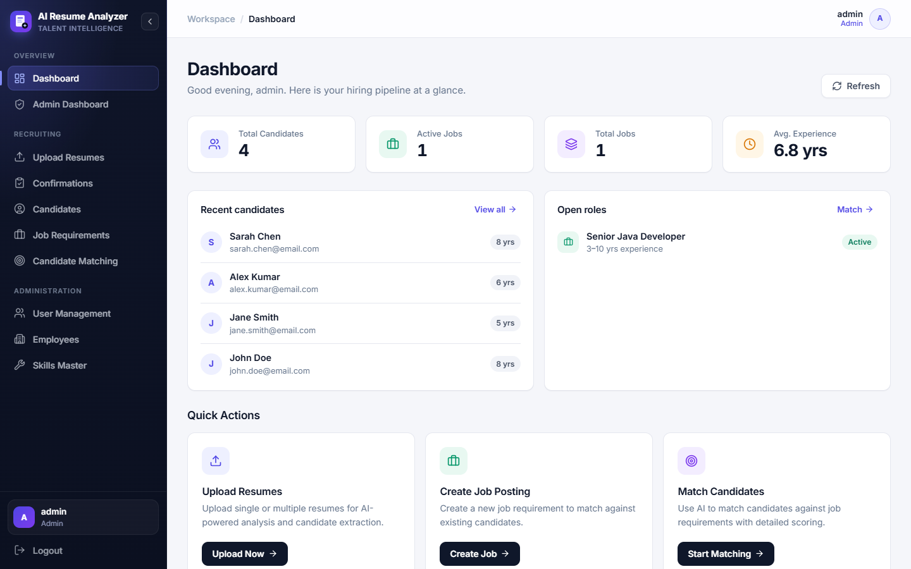
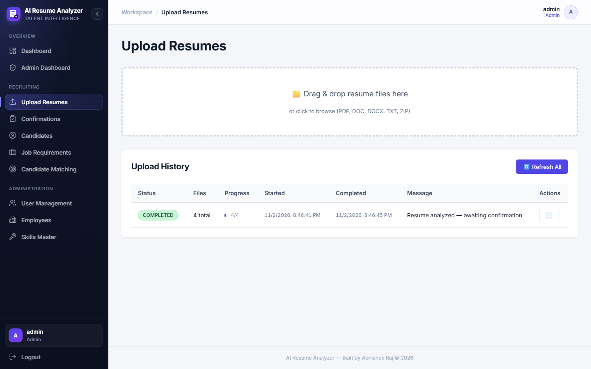
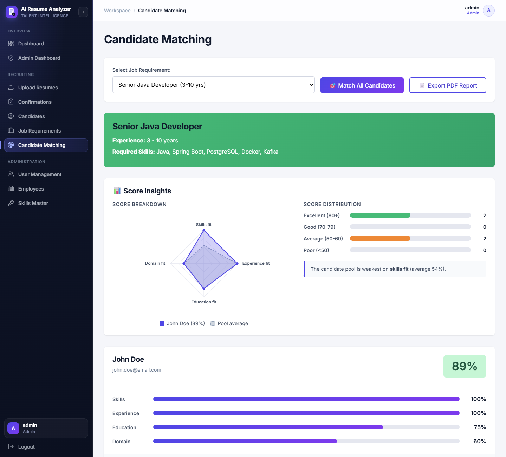
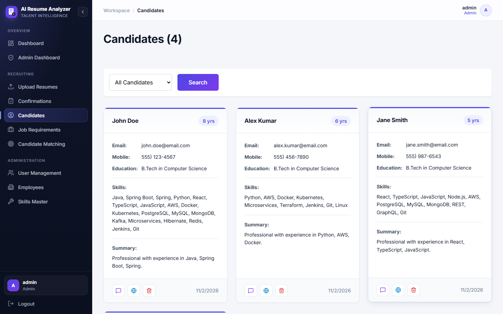
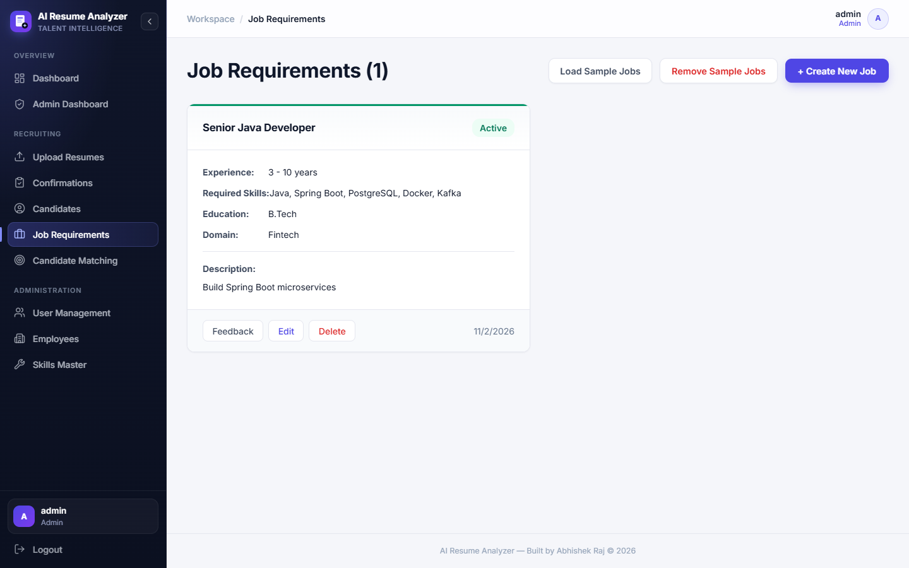

# AI Resume Analyzer

An AI-powered recruitment assistant that parses resumes, extracts structured candidate profiles, and ranks candidates against job requirements using a locally hosted LLM.

Built with **Java 21 / Spring Boot 3**, **Spring AI**, **PostgreSQL + pgvector**, **Apache Pekko**, and a **React 18 + TypeScript** frontend.



---

## ✨ Features

- **Resume parsing** – upload PDF, DOC, DOCX and TXT files, individually, in bulk or as a ZIP. Text is extracted with Apache PDFBox / Apache POI.
- **AI candidate extraction** – the LLM pulls out name, contact details, skills, years of experience, education and a short summary.
- **Semantic search** – resume embeddings are stored in pgvector for similarity search.
- **Job matching** – create job requirements (skills, experience range, education) and let the AI score and rank every candidate, with explanations.
- **Score insights** – a radar chart compares the top candidate with the pool average on skills, experience, education and domain fit, alongside a score distribution and a callout for the pool's weakest area.
- **PDF match reports** – export a ranked, shareable PDF with job details, summary statistics, a score table and the AI analysis for every candidate.
- **Pluggable LLM providers** – run on LM Studio (default), Ollama or OpenAI by switching a Spring profile.
- **Profile enrichment (Agentic RAG)** – optionally enrich candidates with GitHub / LinkedIn / Twitter / web-search context before matching; borderline candidates get a second AI pass.
- **Async processing pipeline** – uploads are queued and processed by an Apache Pekko actor pool, with live progress over Server-Sent Events.
- **Role-based access control** – JWT authentication with four roles: Admin, Recruiter, HR and Hiring Manager.
- **Admin dashboard** – service health checks, match-run audit history, user and employee management.
- **Skills master** – a central catalogue of standardised skill names used for autocomplete and matching.

## 🖼️ Screenshots

| Upload & Tracking | Candidate Matching |
|---|---|
|  |  |

| Candidates | Job Requirements |
|---|---|
|  |  |

## 🏗️ Tech Stack

| Layer | Technology |
|---|---|
| Backend | Java 21, Spring Boot 3.2, Spring Security, Spring for GraphQL |
| AI | Spring AI (OpenAI-compatible client) + LM Studio (local LLM) |
| Async | Apache Pekko (typed actors + streams) |
| Database | PostgreSQL 15 + pgvector, Flyway migrations |
| Frontend | React 18, TypeScript, Redux Toolkit, Redux-Saga, Vite |
| Testing | JUnit 5, Mockito, Testcontainers, Vitest, Playwright |
| Deployment | Docker Compose, Nginx |

## 📁 Project Structure

```
├── src/main/
│   ├── java/com/abhishek/resumeanalyzer/
│   │   ├── config/        # Security, JWT and Spring configuration
│   │   ├── controller/    # REST controllers (upload, auth)
│   │   ├── entities/      # JPA entities
│   │   ├── models/        # DTOs and enums
│   │   ├── pekko/         # Actor pipeline for resume processing
│   │   ├── repos/         # Spring Data repositories
│   │   ├── resolver/      # GraphQL resolvers
│   │   └── services/      # Business logic, AI and enrichment services
│   ├── resources/         # application.yml, Flyway migrations, GraphQL schema
│   └── frontend/          # React + TypeScript single-page app
├── docker/                # Dockerfile, compose files and nginx config
├── docs/                  # Architecture and API documentation
└── test-data/             # Sample resumes and job requirements
```

## 🚀 Getting Started

### Prerequisites

- Java 21 and Maven 3.9+
- Node.js 20+ and Yarn (only for frontend development; the Maven build downloads its own)
- PostgreSQL 15+ with the `vector` extension
- An LLM provider: [LM Studio](https://lmstudio.ai/) (default), [Ollama](https://ollama.com/) or an OpenAI API key. Local providers need a chat model and an embedding model (e.g. `nomic-embed-text`). See [Choosing an LLM provider](#-choosing-an-llm-provider).

### 1. Database

```sql
CREATE DATABASE resume_analyzer;
\c resume_analyzer
CREATE EXTENSION vector;
```

### 2. Configuration

Copy [docs/.env.example](docs/.env.example) and set your values:

```properties
POSTGRES_HOST=localhost
POSTGRES_PORT=5432
POSTGRES_DB=resume_analyzer
POSTGRES_USER=postgres
POSTGRES_PASSWORD=your_password

LLM_STUDIO_BASE_URL=http://localhost:1234   # no /v1 suffix
LLM_STUDIO_API_KEY=not-needed
LLM_STUDIO_MODEL=mistralai/ministral-3-14b-reasoning
LLM_STUDIO_EMBEDDING_MODEL=nomic-embed-text

JWT_SECRET=change-me-to-a-long-random-string
TAVILY_API_KEY=                              # optional, enables web-search enrichment
```

### 3. Run

```bash
# Backend (http://localhost:8080)
mvn spring-boot:run

# Frontend dev server (http://localhost:3000)
cd src/main/frontend
yarn install
yarn dev
```

GraphiQL is available at http://localhost:8080/graphiql.

### Run with Docker

```bash
docker compose up -d
```

See [docs/DOCKER-DEPLOYMENT.md](docs/DOCKER-DEPLOYMENT.md) for details.

### Deploy to Render

[](https://render.com/deploy?repo=https://github.com/Abhishek360007/Ai_Resume_Analyzer)

The [render.yaml](render.yaml) Blueprint creates a Docker web service that uses Google Gemini, which has a free tier. Create a key at [Google AI Studio](https://aistudio.google.com/apikey) and set it as `GEMINI_API_KEY` in the service's **Environment** tab.

The database runs on [Neon](https://neon.tech), whose free PostgreSQL supports pgvector and does not expire (Render's free database is deleted after 30 days). Create a Neon project and, from its connection details with **Connection pooling turned off**, set `DB_HOST`, `DB_NAME`, `DB_USERNAME` and `DB_PASSWORD` in the service's **Environment** tab. Flyway creates the schema and default users on first start.

After the first deploy, log in as `admin` and change every default password under **User Management**.

### Production build

```bash
mvn clean package          # builds the frontend and bundles it into one JAR
java -jar target/resume-analyzer-1.0.0.jar
```

## 🤖 Choosing an LLM Provider

All providers go through Spring AI's OpenAI-compatible client, so you switch provider by switching profile. The code doesn't change.

| Provider | How to enable | Key settings |
|---|---|---|
| LM Studio (default) | nothing to do | `LLM_STUDIO_BASE_URL`, `LLM_STUDIO_MODEL`, `LLM_STUDIO_EMBEDDING_MODEL` |
| Ollama | `SPRING_PROFILES_ACTIVE=ollama` | `OLLAMA_BASE_URL`, `OLLAMA_MODEL`, `OLLAMA_EMBEDDING_MODEL` |
| OpenAI | `SPRING_PROFILES_ACTIVE=openai` | `OPENAI_API_KEY`, `OPENAI_MODEL`, `OPENAI_EMBEDDING_MODEL` |
| Google Gemini (free tier) | `SPRING_PROFILES_ACTIVE=gemini` | `GEMINI_API_KEY`, `GEMINI_MODEL`, `GEMINI_EMBEDDING_MODEL` |

```bash
# Example: run with Ollama
ollama pull llama3.1:8b && ollama pull nomic-embed-text
SPRING_PROFILES_ACTIVE=ollama mvn spring-boot:run
```

**Gemini free tier:** no card is needed, but Google may use submitted content to improve its products, so use sample resumes rather than real candidates' data.

Embeddings are stored in a `vector(768)` column. `nomic-embed-text` produces 768 dimensions natively, and the OpenAI profile asks `text-embedding-3-small` for 768 dimensions. The admin dashboard health check reports the active provider by name.

## 📄 Match Reports

On the **Candidate Matching** page, select a job and click **📄 Export PDF Report**. The report is also available over REST for any authenticated role:

```
GET /api/reports/jobs/{jobRequirementId}/matches.pdf
Authorization: Bearer <access token>
```

## 🔐 Default Users

These users are seeded on first run. **Change the passwords before you deploy anywhere.**

| Username | Password | Role |
|---|---|---|
| `admin` | `Admin@123` | ADMIN |
| `recruiter` | `Recruiter@123` | RECRUITER |
| `hr` | `HR@123` | HR |
| `hiring_manager` | `Manager@123` | HIRING_MANAGER |

## 🧪 Testing

```bash
# Backend unit and integration tests
mvn test

# Frontend unit tests
cd src/main/frontend && yarn test

# End-to-end tests (Playwright)
cd src/main/frontend && yarn test:e2e
```

## 📚 Documentation

- [Architecture](docs/ARCHITECTURE.md)
- [GraphQL API](docs/GRAPHQL-API.md)
- [Agentic RAG enrichment](docs/AGENTIC-RAG.md)
- [LM Studio setup](docs/LLM-STUDIO-SETUP.md)
- [Docker deployment](docs/DOCKER-DEPLOYMENT.md)
- [HTTPS setup](docs/HTTPS-SETUP.md)
- [Skills management](docs/SKILLS-MANAGEMENT.md)
- [Roadmap](docs/FUTURE-ENHANCEMENTS.md)

## 🙏 Acknowledgements

This project is based on the open-source [spring-boot-ai-resume-analyzer](https://github.com/d-subrahmanyam/spring-boot-ai-resume-analyzer), released under the MIT License, and has been restructured and customised.

## 📄 License

Released under the [MIT License](LICENSE).

## 👤 Author

**Abhishek Raj** – [GitHub @Abhishek360007](https://github.com/Abhishek360007)
