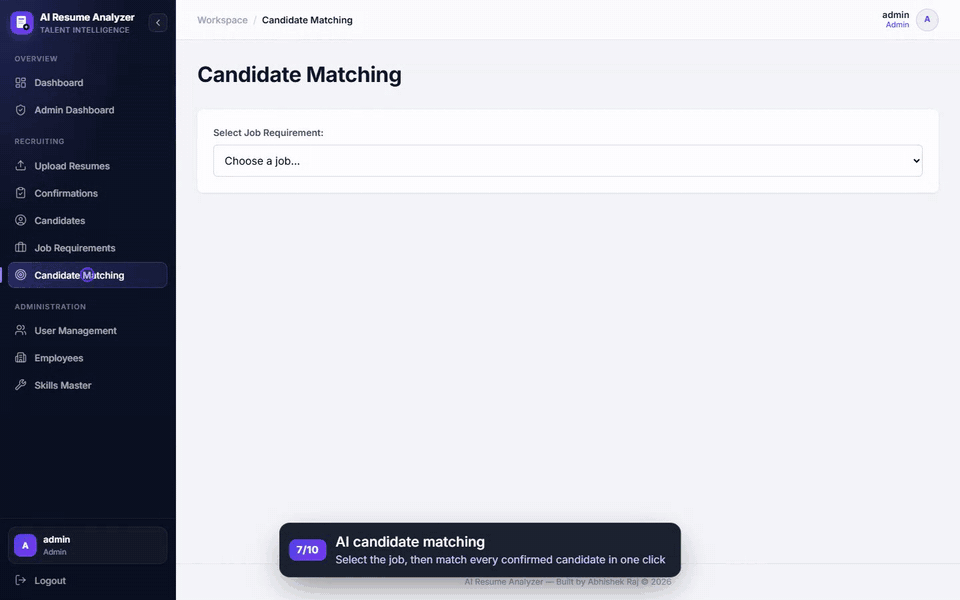
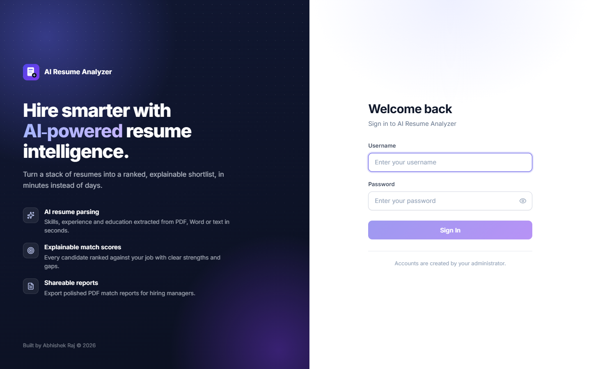
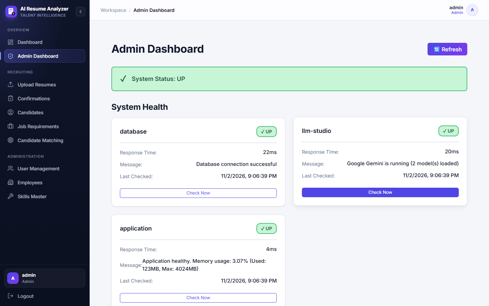

# AI Resume Analyzer

An AI-powered recruitment assistant that parses resumes, extracts structured candidate profiles, and ranks every candidate against a job requirement, with a score and a clear explanation for each one.

Built with **Java 21 / Spring Boot 3**, **Spring AI**, **PostgreSQL + pgvector**, **Apache Pekko**, and a **React 18 + TypeScript** frontend.

**🎬 Demo video:** [Watch the 3-minute walkthrough](docs/demo/ai-resume-analyzer-demo.mp4) (captioned, end to end)
**🌐 Live demo:** [ai-resume-analyzer-nwh6.onrender.com](https://ai-resume-analyzer-nwh6.onrender.com) (free hosting: the first visit after a quiet period can take a few minutes to wake up)
**📘 Project guide:** [AI-Resume-Analyzer-Project-Guide.pdf](docs/AI-Resume-Analyzer-Project-Guide.pdf), a 30-page walkthrough of every feature, the AI, the architecture and how to present the project

[](docs/demo/ai-resume-analyzer-demo.mp4)

## 🎬 Demo Video

[**▶ Watch the full demo (3 min 16 s)**](docs/demo/ai-resume-analyzer-demo.mp4). Every step is captioned:

1. Secure sign-in with role-based accounts
2. Dashboard overview
3. Creating a job requirement (skills, experience, education, domain)
4. Uploading a batch of resumes, processed in the background
5. Reviewing and confirming AI-extracted candidates (human in the loop)
6. Candidate profiles built by AI
7. AI matching with RAG, explainable scores, score insights and PDF export
8. Admin dashboard: health checks, processing queue and match-run audit
9. User management and roles
10. Role-based access as a recruiter


---

## ✨ Features

- **Resume parsing**: upload PDF, DOC, DOCX and TXT files, individually, in bulk or as a ZIP. Text is extracted with Apache PDFBox / Apache POI.
- **AI candidate extraction**: the LLM pulls out name, contact details, skills, years of experience, education, domain knowledge, work history and a short summary.
- **Human in the loop**: extracted candidates wait on a Confirmations page until a recruiter checks and confirms them.
- **Semantic search (RAG)**: resume sections are embedded and stored in pgvector; matching retrieves the sections most relevant to the job.
- **Explainable job matching**: every candidate gets skills, experience, education and domain scores (weighted 40/25/20/15), plus strengths, gaps and a recommendation. Scores of 70%+ are shortlisted automatically.
- **Score insights**: a radar chart compares the top candidate with the pool average, alongside a score distribution and a callout for the pool's weakest area.
- **PDF match reports**: export a ranked, shareable PDF with job details, summary statistics, a score table and the AI analysis for every candidate.
- **Pluggable LLM providers**: Google Gemini, OpenAI, Ollama or LM Studio, chosen with a Spring profile.
- **Profile enrichment (Agentic RAG)**: optionally enrich candidates with GitHub / LinkedIn / Twitter / web-search context; borderline candidates get a second AI pass.
- **Async processing pipeline**: uploads are queued and processed by an Apache Pekko actor pool, with retries, stale-job recovery and live progress over Server-Sent Events.
- **Role-based access control**: JWT authentication with four roles (Admin, Recruiter, HR, Hiring Manager), enforced on every API operation.
- **Admin dashboard**: health checks for the database and AI provider, queue statistics, match-run audit history, user and employee management.
- **Skills master**: a central catalogue of standardised skill names used for autocomplete and matching.

## 🖼️ Screenshots

| Candidate Matching | Upload & Live Tracking |
|---|---|
|  |  |

| Candidates | Job Requirements |
|---|---|
|  |  |

| Login | Admin Dashboard |
|---|---|
|  |  |

## 🏗️ Tech Stack

| Layer | Technology |
|---|---|
| Backend | Java 21, Spring Boot 3.2, Spring Security (JWT), Spring for GraphQL |
| AI | Spring AI (OpenAI-compatible client) with Google Gemini, OpenAI, Ollama or LM Studio |
| Async | Apache Pekko (typed actors + streams), database-backed job queue |
| Database | PostgreSQL 16 + pgvector, Flyway migrations |
| Frontend | React 18, TypeScript, Redux Toolkit, Redux-Saga, Vite |
| Testing | JUnit 5, Mockito, Vitest, Playwright |
| Deployment | Docker, Render (Blueprint) + Neon; Docker Compose + Nginx for self-hosting |

## 📁 Project Structure

```
├── src/main/
│   ├── java/com/abhishek/resumeanalyzer/
│   │   ├── config/        # Security, JWT and Spring configuration
│   │   ├── controller/    # REST controllers (auth, upload, reports)
│   │   ├── entities/      # JPA entities
│   │   ├── models/        # DTOs and enums
│   │   ├── pekko/         # Actor pipeline for resume processing
│   │   ├── repos/         # Spring Data repositories
│   │   ├── resolver/      # GraphQL resolvers
│   │   └── services/      # Business logic, AI and enrichment services
│   ├── resources/         # application.yml, provider profiles, Flyway migrations, GraphQL schema
│   └── frontend/          # React + TypeScript single-page app
├── docker/                # Dockerfile, compose files and nginx config
├── docs/                  # Project guide, architecture and API documentation
├── render.yaml            # Render Blueprint (infrastructure as code)
└── test-data/             # Sample resumes and job requirements
```

## 🚀 Getting Started

### Prerequisites

- Java 21 and Maven 3.9+
- Node.js 20+ and Yarn (only for frontend development; the Maven build downloads its own)
- PostgreSQL 15+ with the `vector` extension (or the `pgvector/pgvector:pg16` Docker image)
- An LLM provider: a [Google Gemini](https://aistudio.google.com/apikey) or OpenAI API key, or a local [LM Studio](https://lmstudio.ai/) / [Ollama](https://ollama.com/) server. See [Choosing an LLM provider](#-choosing-an-llm-provider).

### 1. Database

```bash
docker run -d --name resume-db -p 5432:5432 \
  -e POSTGRES_DB=resume_analyzer -e POSTGRES_USER=postgres -e POSTGRES_PASSWORD=postgres \
  pgvector/pgvector:pg16
```

Flyway creates the schema, enables `vector` and seeds the default users on first start.

### 2. Configuration

Copy [docs/.env.example](docs/.env.example) and set your values. The main settings:

```properties
DB_HOST=localhost
DB_PORT=5432
DB_NAME=resume_analyzer
DB_USERNAME=postgres
DB_PASSWORD=postgres
DB_SSL_MODE=prefer                 # use "require" for hosted databases such as Neon

SPRING_PROFILES_ACTIVE=gemini      # or openai / ollama; omit for LM Studio
GEMINI_API_KEY=your-key-here

JWT_SECRET=change-me-to-a-long-random-string
TAVILY_API_KEY=                    # optional, enables web-search enrichment
```

### 3. Run

```bash
# Backend (http://localhost:8080)
mvn spring-boot:run

# Frontend dev server (http://localhost:3000)
cd src/main/frontend
yarn install
yarn dev
```

GraphiQL is available at http://localhost:8080/graphiql.

### Run with Docker

```bash
docker compose up -d
```

See [docs/DOCKER-DEPLOYMENT.md](docs/DOCKER-DEPLOYMENT.md) for details.

### Deploy to Render

[](https://render.com/deploy?repo=https://github.com/Abhishek360007/Ai_Resume_Analyzer)

The [render.yaml](render.yaml) Blueprint creates a Docker web service that uses Google Gemini, which has a free tier. Create a key at [Google AI Studio](https://aistudio.google.com/apikey) and set it as `GEMINI_API_KEY` in the service's **Environment** tab.

The database runs on [Neon](https://neon.tech), whose free PostgreSQL supports pgvector and does not expire (Render's free database is deleted after 30 days). Create a Neon project **in the same region as your Render service** and, from its connection details with **Connection pooling turned off**, set `DB_HOST`, `DB_NAME`, `DB_USERNAME` and `DB_PASSWORD` in the service's **Environment** tab. Flyway creates the schema and default users on first start.

After the first deploy, log in as `admin` and change every default password under **User Management**.

### Production build

```bash
mvn clean package          # builds the frontend and bundles it into one JAR
java -jar target/resume-analyzer-1.0.0.jar
```

## 🤖 Choosing an LLM Provider

All providers go through Spring AI's OpenAI-compatible client, so you switch provider by switching profile. The code doesn't change.

| Provider | How to enable | Key settings |
|---|---|---|
| Google Gemini (free tier) | `SPRING_PROFILES_ACTIVE=gemini` | `GEMINI_API_KEY`, `GEMINI_MODEL`, `GEMINI_EMBEDDING_MODEL` |
| OpenAI | `SPRING_PROFILES_ACTIVE=openai` | `OPENAI_API_KEY`, `OPENAI_MODEL`, `OPENAI_EMBEDDING_MODEL` |
| Ollama | `SPRING_PROFILES_ACTIVE=ollama` | `OLLAMA_BASE_URL`, `OLLAMA_MODEL`, `OLLAMA_EMBEDDING_MODEL` |
| LM Studio (default) | nothing to do | `LLM_STUDIO_BASE_URL`, `LLM_STUDIO_MODEL`, `LLM_STUDIO_EMBEDDING_MODEL` |

```bash
# Example: run with Ollama
ollama pull llama3.1:8b && ollama pull nomic-embed-text
SPRING_PROFILES_ACTIVE=ollama mvn spring-boot:run
```

**Gemini free tier:** no card is needed, but Google may use submitted content to improve its products, so use sample resumes rather than real candidates' data. Rate-limited requests (HTTP 429/503) are retried automatically with back-off. If Google retires a model, set `GEMINI_MODEL` to its replacement; no code change is needed.

Embeddings are stored in a `vector(768)` column. Gemini and OpenAI are asked for 768 dimensions (longer vectors are shortened and re-normalised), and `nomic-embed-text` produces 768 natively. The admin dashboard health check reports the active provider by name.

## 📄 Match Reports

On the **Candidate Matching** page, select a job and click **Export PDF Report**. The report is also available over REST for any authenticated role:

```
GET /api/reports/jobs/{jobRequirementId}/matches.pdf
Authorization: Bearer <access token>
```

## 🔐 Default Users

These users are seeded on first run for local development. **Change the passwords before you deploy anywhere.** The live demo does not use them.

| Username | Password | Role |
|---|---|---|
| `admin` | `Admin@123` | ADMIN |
| `recruiter` | `Recruiter@123` | RECRUITER |
| `hr` | `HR@123` | HR |
| `hiring_manager` | `Manager@123` | HIRING_MANAGER |

## 🧪 Testing

| Suite | Tests | Command |
|---|---|---|
| Backend (JUnit 5, Mockito) | 201 | `mvn test` |
| Frontend unit (Vitest) | 106 | `cd src/main/frontend && yarn test` |
| End-to-end (Playwright, every role) | 103 | `cd src/main/frontend && yarn test:e2e` |

A security test fails the build if any GraphQL query or mutation is missing a `@PreAuthorize` rule.

## 📚 Documentation

- [Project guide (PDF)](docs/AI-Resume-Analyzer-Project-Guide.pdf)
- [Architecture](docs/ARCHITECTURE.md)
- [GraphQL API](docs/GRAPHQL-API.md)
- [Agentic RAG enrichment](docs/AGENTIC-RAG.md)
- [LM Studio setup](docs/LLM-STUDIO-SETUP.md)
- [Docker deployment](docs/DOCKER-DEPLOYMENT.md)
- [HTTPS setup](docs/HTTPS-SETUP.md)
- [Skills management](docs/SKILLS-MANAGEMENT.md)
- [Roadmap](docs/FUTURE-ENHANCEMENTS.md)

## 🙏 Acknowledgements

This project is based on the open-source [spring-boot-ai-resume-analyzer](https://github.com/d-subrahmanyam/spring-boot-ai-resume-analyzer), released under the MIT License. It has since been extended with Google Gemini support, PDF reports and score insights, a cloud deployment on Render and Neon, reliability and security fixes, and a redesigned user interface.

## 📄 License

Released under the [MIT License](LICENSE).

## 👤 Author

**Abhishek Raj**: [GitHub @Abhishek360007](https://github.com/Abhishek360007)
